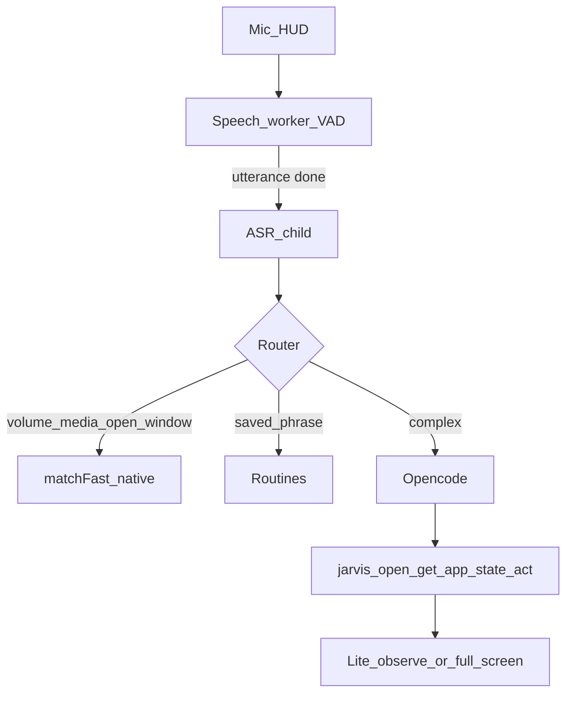

# Полная оптимизация Jarvis: слух, команды, управление ПК

Цель: пока вы говорите длинный запрос — **не обрезает**; типовые команды идут **мгновенно** без модели; сложное управление ПК — **меньше лишних сканов**, точнее клики. Плюс микрофон сам восстанавливается после ошибки `0x88890004` (`AUDCLNT_E_DEVICE_INVALIDATED`).

---

## Чеклист задач

- [ ] **A. Слух** — `worker.ts`: терпеливее конец фразы + незавершённый partial + ignore после TTS
- [ ] **A. Микрофон** — `audio.tsx`: `devicechange` / `track.onended` → `startMic` с debounce
- [ ] **B. Fast PC** — `fast-commands` + `assistant`: open / focus / close / snap / brightness
- [ ] **B. Routines** — `matchRoutine` порог ~0.75
- [ ] **C. Computer** — lite observe после клика; prompt предпочитает open / get_app_state / click_text
- [ ] **Проверка** — ручные сценарии ниже + `npm run typecheck`

---

## A. Слушать до конца запроса

Файл: [`src/main/speech/worker.ts`](src/main/speech/worker.ts)

### Проблема сейчас

Конец фразы режется двумя механизмами сразу:

| Механизм | Сейчас | Эффект |
|----------|--------|--------|
| Energy endpointing | `endMs = min(1500, 650 + uttMs * 0.07)` в command mode | пауза ~0.65–1.5 с = «готово» |
| Silero VAD | `minSilenceDuration: 0.6` | ещё один ранний обрыв |

Пауза «подумать посередине» часто обрывает длинный запрос на два куска.

### Что меняем

#### 1. Command mode терпеливее к паузам

- База тишины: **~1100–1200 мс** вместо ~650
- Потолок: **~2200–2500 мс** вместо 1500
- Формула: `endMs = min(2400, 1100 + uttMs * 0.08)`
- Wake mode оставить быстрее (только имя «Джарвис»)

#### 2. Не резать «незаконченную» речь

Если streaming partial оканчивается на союз / предлог / висящую конструкцию:

- RU: `и`, `на`, `чтобы`, `открой`, `сделай`, `поставь`…
- EN: `and`, `to`, `the`, `open`, `please`…

→ требовать ещё **~400–600 мс** тишины сверх `endMs`.

Также: порог quiet (`peak * 0.2`) чуть смягчить для тихих микрофонов (ниже коэффициент или выше floor), чтобы шёпот/далёкий mic не считались «тишиной» слишком рано.

#### 3. После TTS не слушать эхо

Сейчас: `ignoreUntil = now + 250` после `speaking(false)` — мало.

- Поднять до **~600–800 мс**
- Ack «Да, сэр» не должен становиться командой и не должен обрезать ваш следующий запрос

#### 4. Окно follow-up

- `followupSeconds` (default **7**) оставить
- При wake-only уже зовётся `listenFor` — ок
- Command-mode timeout уже не рвёт `inSpeech` на середине (`expire` ждёт конца utterance)

#### 5. Микрофон всегда живой

Файл: [`src/renderer/src/audio.tsx`](src/renderer/src/audio.tsx)

- `track.onended` / `track.onmute` → `startMic()`
- `navigator.mediaDevices.ondevicechange` → если `default` или выбранный device пропал → переоткрыть
- Debounce **~600 мс**
- При ошибке `getUserMedia` — retry 4 с + явный сброс старого stream

**Эффект:** `0x88890004` больше не «убивает» слух до ручного рестарта.

> UI-слайдер «пауза конца фразы» — позже; в этом спринте достаточно новых констант в коде.

---

## B. Команды: быстро и правильно

### B1. Мгновенный слой без модели

Файлы:

- [`src/main/fast-commands.ts`](src/main/fast-commands.ts)
- [`src/main/assistant.ts`](src/main/assistant.ts) (ветка ~511–524)

Сейчас умеет: volume / media / show_desktop / lock.

**Добавить** (native уже есть — `SystemControl`, `Apps`, `Program.cs`):

| Фраза (примерно) | Действие |
|------------------|----------|
| открой / open **X** | `open_app` |
| переключи на / focus **X** | focus окна по app/title |
| закрой окно / сверни / разверни / на весь экран | window action |
| налево / направо (половину) | `snap_left` / `snap_right` |
| ярче / тусклее / яркость **N** | brightness |
| громче / пауза / рабочий стол | уже есть |

Правила:

- короткие regex + нормализация как сейчас
- лимит длины фразы **~80** символов
- длиннее / сложнее → routines или agent

**Эффект:** типовое управление ПК за ~300 мс вместо полного turn агента.

### B2. Сохранённые команды (routines)

В `matchRoutine` (`assistant.ts`):

- порог `0.82` → **~0.75**
- опечатки ASR ловятся через `phraseScore` / `normalize`

Если routine сработала — **не** будить и не ждать opencode.

### B3. Роутер не портит длинный запрос

- Незаконченный partial («открой…») дослушивается за счёт пункта A
- После wake+команда в одной фразе: `void this.ack` — **не ждать** TTS перед `handleCommand` (уже так — сохранить)

---

## C. Управление компьютером: быстрее и надёжнее

Файлы:

- [`src/main/computer.ts`](src/main/computer.ts)
- [`src/main/mcp.ts`](src/main/mcp.ts)
- [`src/main/agent-prompt.ts`](src/main/agent-prompt.ts)

### C1. Дешёвый observe после клика

Сейчас `observe(prev, settleMs = 450)` всегда делает полный `scan()`:

`screenshot + OCR + UIA` ≈ **1–3 с** на каждый клик.

**Новое поведение:**

| Ситуация | Scan |
|----------|------|
| После `jarvis_act` / `click_text` / простых window actions | **lite**: только UIA foreground, **без OCR**, settle ~250–300 мс |
| `jarvis_screen` / `ask_screen` | полный OCR+UIA |
| Lite сказал «unchanged», модель ретраит | escalation на полный scan (не чаще 1 раза) |

### C2. Подсказки модели

В `JARVIS_PROMPT` и описаниях tools усилить:

1. Сначала `jarvis_open_app` / `get_app_state` / `click_text`
2. Не звать `jarvis_screen` на каждый шаг
3. Win32/UIA-приложения → tree tools; OCR → Telegram / Discord / игры / canvas
4. Loop guard **не трогать** логику — только тексты подсказок

### C3. Стабильность кликов

Уже есть: UIA invoke без мыши → mouse fallback; retry если текст не найден.

Дожать: при «Screen unchanged» после клика — один авто-retry с полным scan (lite → full escalation).

---

## Порядок внедрения

1. Слух: endpointing + ignoreAfterTTS + mic recovery  
2. Fast PC commands + wiring в `handleCommand`  
3. Lite observe + правки prompt / tools  
4. Мягче routines + `npm run typecheck`  

---

## Проверка вручную

| Сценарий | Ожидание |
|----------|----------|
| Говорите 8–12 с с паузами «эээ…» посередине | Один цельный transcript, не два обрывка |
| «Джарвис… (пауза 1 с) …открой калькулятор и посчитай 12×7» | Дослушивает, потом действует |
| «Громче / пауза / открой Telegram / сверни окно» | В чате `⚡`, без «Думает» |
| Сложная UI-задача | Агент; после клика scan быстрее (без OCR), полный — только на `jarvis_screen` |
| Выдернуть USB-mic / сменить default | Снова слышит без рестарта приложения |
| `npm run typecheck` | Проходит |

---

## Вне скоупа

- Новый UI / редизайн / macOS / Linux  
- Смена ASR-моделей / XTTS  
- Новые MCP-коннекторы  
- Полный редизайн agent harness  

---

## Ключевые файлы

| Файл | Зачем |
|------|--------|
| `src/main/speech/worker.ts` | Конец фразы, VAD, ignore после TTS |
| `src/renderer/src/audio.tsx` | Захват микрофона, восстановление устройства |
| `src/main/fast-commands.ts` | Мгновенные команды без LLM |
| `src/main/assistant.ts` | Роутер: fast → routine → agent; `matchRoutine` |
| `src/main/computer.ts` | Scan / observe / клики |
| `src/main/mcp.ts` | Tools агента, settle после действий |
| `src/main/agent-prompt.ts` | Инструкции модели по computer use |
| `native/JarvisNative/SystemControl.cs` | volume / window / desktop / brightness |
