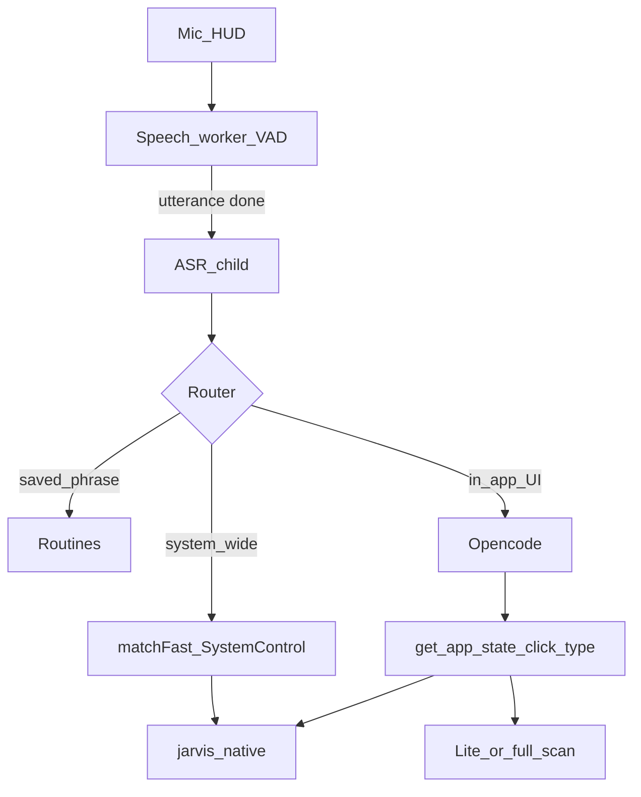

# Полная оптимизация Jarvis: слух, команды, управление ПК

Цель: пока вы говорите длинный запрос — **не обрезает**; **вся система** (звук, окна, яркость, медиа, рабочий стол) управляется **тонко и мгновенно** без модели где возможно; в приложениях — точные клики/ввод. Плюс микрофон сам восстанавливается после `0x88890004`.



---

## Чеклист задач

- [ ] **A. Слух** — `worker.ts`: терпеливее конец фразы + незавершённый partial + ignore после TTS
- [ ] **A. Микрофон** — `audio.tsx`: `devicechange` / `track.onended` → `startMic` с debounce
- [ ] **B. Fast PC** — open / focus / close / snap / brightness
- [ ] **B. Routines** — `matchRoutine` порог ~0.75
- [ ] **D. Система тонко** — громкость по приложению, окна (snap/monitor/topmost), яркость step, screen_off; всё через fast где фраза короткая
- [ ] **C. Computer скорость** — lite observe; OCR по нужде
- [ ] **C. Computer точность** — фокус перед type/keys; UIA-first; раздельные id
- [ ] **C. Computer settle / клики** — Settle окна; спорные hits → кандидаты
- [ ] **Проверка** — ручные сценарии + `npm run typecheck`

---

## A. Слушать до конца запроса

Файл: [`src/main/speech/worker.ts`](src/main/speech/worker.ts)

### Проблема сейчас

Конец фразы режется двумя механизмами сразу:

| Механизм | Сейчас | Эффект |
|----------|--------|--------|
| Energy endpointing | `endMs = min(1500, 650 + uttMs * 0.07)` в command mode | пауза ~0.65–1.5 с = «готово» |
| Silero VAD | `minSilenceDuration: 0.6` | ещё один ранний обрыв |

Пауза «подумать посередине» часто обрывает длинный запрос на два куска.

### Что меняем

#### 1. Command mode терпеливее к паузам

- База тишины: **~1100–1200 мс** вместо ~650
- Потолок: **~2200–2500 мс** вместо 1500
- Формула: `endMs = min(2400, 1100 + uttMs * 0.08)`
- Wake mode оставить быстрее (только имя «Джарвис»)

#### 2. Не резать «незаконченную» речь

Если streaming partial оканчивается на союз / предлог / висящую конструкцию:

- RU: `и`, `на`, `чтобы`, `открой`, `сделай`, `поставь`…
- EN: `and`, `to`, `the`, `open`, `please`…

→ требовать ещё **~400–600 мс** тишины сверх `endMs`.

Также: порог quiet (`peak * 0.2`) чуть смягчить для тихих микрофонов (ниже коэффициент или выше floor), чтобы шёпот/далёкий mic не считались «тишиной» слишком рано.

#### 3. После TTS не слушать эхо

Сейчас: `ignoreUntil = now + 250` после `speaking(false)` — мало.

- Поднять до **~600–800 мс**
- Ack «Да, сэр» не должен становиться командой и не должен обрезать ваш следующий запрос

#### 4. Окно follow-up

- `followupSeconds` (default **7**) оставить
- При wake-only уже зовётся `listenFor` — ок
- Command-mode timeout уже не рвёт `inSpeech` на середине (`expire` ждёт конца utterance)

#### 5. Микрофон всегда живой

Файл: [`src/renderer/src/audio.tsx`](src/renderer/src/audio.tsx)

- `track.onended` / `track.onmute` → `startMic()`
- `navigator.mediaDevices.ondevicechange` → если `default` или выбранный device пропал → переоткрыть
- Debounce **~600 мс**
- При ошибке `getUserMedia` — retry 4 с + явный сброс старого stream

**Эффект:** `0x88890004` больше не «убивает» слух до ручного рестарта.

> UI-слайдер «пауза конца фразы» — позже; в этом спринте достаточно новых констант в коде.

---

## B. Команды: быстро и правильно

### B1. Мгновенный слой без модели

Файлы:

- [`src/main/fast-commands.ts`](src/main/fast-commands.ts)
- [`src/main/assistant.ts`](src/main/assistant.ts) (ветка ~511–524)

Сейчас умеет: volume / media / show_desktop / lock.

**Добавить** — см. полный каталог в разделе **D** (native уже умеет почти всё в `SystemControl.cs`).

Правила:

- короткие regex + нормализация как сейчас
- лимит длины фразы **~80** символов
- длиннее / «открой X и нажми Y» → routines или agent
- системные команды **никогда** не должны ждать LLM, если матч однозначный

**Эффект:** управление всей системой за ~300 мс вместо turn агента.

### B2. Сохранённые команды (routines)

В `matchRoutine` (`assistant.ts`):

- порог `0.82` → **~0.75**
- опечатки ASR ловятся через `phraseScore` / `normalize`

Если routine сработала — **не** будить и не ждать opencode.

### B3. Роутер не портит длинный запрос

- Незаконченный partial («открой…») дослушивается за счёт пункта A
- После wake+команда в одной фразе: `void this.ack` — **не ждать** TTS перед `handleCommand` (уже так — сохранить)

---

## C. Управление компьютером: быстрее, точнее, правильнее

Файлы:

- [`src/main/computer.ts`](src/main/computer.ts)
- [`src/main/mcp.ts`](src/main/mcp.ts)
- [`src/main/agent-prompt.ts`](src/main/agent-prompt.ts)
- [`native/JarvisNative/`](native/JarvisNative/) (`Windows.Settle`, `Activate`, UIA, OCR)

Сейчас две дорожки:

1. **Codex-style** — `get_app_state` + click/set_value/press_key по окну (activate + wait settle + свежее дерево) — точнее для обычных Win-приложений  
2. **Screen map** — `jarvis_screen` / `click_text` (UIA∪OCR по всему экрану) — нужно для Telegram/Discord/игр, но медленнее и чаще промахи

Цель оптимизации: **чаще ходить по дорожке 1**, дорожку 2 ускорить и сделать клики/фокус надёжнее.

### C0. Типичные ошибки сейчас (что чиним)

| Проблема | Почему | Как правильнее |
|----------|--------|----------------|
| Кликнул не туда / не то окно | Ввод уходит в foreground; UIA-click иногда **не фокусирует** окно | Перед `keys` / `type` всегда `focusApp` / Activate целевого hwnd (частично есть — дожать везде) |
| Устаревший номер элемента `[N]` | После UI-смены старая карта screen | После каждого действия возвращать свежий digest; запретить в prompt использовать старые id |
| Долго «думает» между кликами | `observe()` = полный screenshot+OCR+UIA (~1–3 с) | Lite observe (только UIA), OCR по запросу |
| Не дождался отрисовки меню | Фиксированный settle 450–650 мс | Использовать native `Settle` / fingerprint окна (уже есть в C#) вместо слепого sleep где возможно |
| Два одинаковых текста на экране | `click_text` берёт top match | Возвращать топ-3 кандидата + `nth`; предпочитать interactive UIA (Button/MenuItem) над голым OCR |
| Печать не в то поле | Фокус не в Edit | Сначала click/set_value по element_index из `get_app_state`, не «type в воздух» |
| Путает screen-id и element_index | Две разные нумерации | В tool errors/prompt жёстко: `get_app_state` → click(element_index); `jarvis_screen` → jarvis_act(id) — не смешивать |

### C1. Дешёвый observe после клика (скорость)

Сейчас `observe(prev, settleMs = 450)` всегда полный `scan()` ≈ **1–3 с**.

| Ситуация | Scan |
|----------|------|
| После `jarvis_act` / `click_text` / простых window actions | **lite**: UIA foreground, **без OCR**, settle ~250–300 мс |
| `jarvis_screen` / `ask_screen` | полный OCR+UIA |
| Lite: «unchanged», нужен ретрай | один escalation на полный scan |

### C2. Правильный выбор стратегии (точность)

В `JARVIS_PROMPT` + descriptions tools зафиксировать порядок:

1. **Открыть / найти окно:** `jarvis_open_app` → `jarvis_list_apps` → запомнить window id  
2. **Обычное приложение (Калькулятор, Проводник, настройки, браузер с UIA):** `get_app_state(window)` → `click` / `set_value` / `press_key` / `type_text`  
3. **Кастомный UI (Telegram, Discord, игры, canvas):** screenshot из state → click x,y **или** `jarvis_screen` + `click_text`  
4. **Не** звать `jarvis_screen` на каждый шаг, если дерево UIA уже живое  
5. После 2 неудачных одинаковых действий — смена стратегии (уже loop guard; тексты усилить)

### C3. Фокус и ввод — всегда в нужное окно

- Перед любой печатью / хоткеем: Activate целевого окна (как в `focusApp` / native window actions)  
- После Activate — короткая проверка foreground process совпал; если нет — один retry Activate  
- `jarvis_type` / `press_key`: параметр `app` / `window` обязателен в подсказке модели, когда работа идёт не с текущим foreground  
- Не слать media/volume через agent, если сработал `matchFast` (слой B)

### C4. Стабильность кликов

Уже есть: UIA invoke без мыши → mouse fallback; retry scan если текст не найден.

Дожать:

- При «Screen unchanged» после клика — **один** авто-retry: полный scan + повтор click (не бесконечный цикл)  
- В `find()` сильнее бонус interactive controls (Button, MenuItem, TabItem, ListItem) vs Text/Group  
- Если score лучшего hit &lt; 0.85 и есть 2+ близких — вернуть ошибку с кандидатами, а не молча кликать первый  
- Highlight кружком перед кликом оставить (уже есть) — полезно для отладки глазами

### C5. Ждать UI «успокоился», а не sleep наугад

Native уже умеет `Fingerprint` + `Settle` по окну (`Windows.cs` / `wait_settle`).

План:

- После open_app / click, открывающего меню: вызывать settle по **hwnd цели**, а не только фиксированные 450/650/900 мс  
- Верхний лимит settle оставить (чтобы не висеть на анимациях)  
- Для `observe` lite: сначала settle, потом UIA — меньше «пустых» снимков

### C6. Меньше путаницы id для модели

- В ответах tools явно писать префикс: `screen#12` vs `uia#34` / `element_index=34`  
- Ошибка при смешении: «это id из jarvis_screen — используй jarvis_act; для get_app_state — click(element_index)»  
- Индексы из прошлого `get_app_state` считать недействительными после любого действия (уже частично в prompt — усилить)

### C7. Что сознательно не ломаем

- Loop guard (3 одинаковых вызова / 45 actions) — **оставить**  
- Согласие на управление ПК на чат + рамка + Ctrl+Alt+K — **оставить**  
- Состояние UI **«Думает»** — **не трогать**

---

## D. Тонкое управление всей системой (не только клики в UI)

Идея: **система** (звук, окна, яркость, медиа, рабочий стол, питание экрана) — отдельный быстрый слой. Agent нужен для «нажми вот эту кнопку в приложении», а не для «сделай потише Spotify».

Native уже умеет почти всё в [`SystemControl.cs`](native/JarvisNative/SystemControl.cs); agent tools (`jarvis_volume`, `jarvis_desktop`, window actions) уже есть в [`mcp.ts`](src/main/mcp.ts). Дыра: **голос** часто не попадает в `matchFast` → уходит в медленный LLM.

### D1. Каталог системных команд → native (расширить matchFast + wiring)

#### Звук (мастер)

| Фраза | API |
|-------|-----|
| громче / тише / громкость N / mute | `volume` set/up/down/mute — **уже есть** |
| какая громкость | `volume` get → коротко сказать число |

#### Звук по приложению (тонко)

| Фраза | API |
|-------|-----|
| тише Spotify / громче Chrome / заглуши Яндекс Музыку | `volume` + `app` (уже в native `AppVolume`) |
| громкость Telegram 30 | `app` + set level |

Важно: приложение должно **сейчас играть звук** (сессии Core Audio) — если нет сессии, ответить ясно («сейчас не играет»), не слать в agent.

#### Медиа

| Фраза | API |
|-------|-----|
| пауза / дальше / назад / play | media keys — **уже есть** |

#### Окна (текущее или по имени)

| Фраза | API (`Window` action) |
|-------|------------------------|
| сверни / разверни / восстанови / закрой (окно) | minimize / maximize / restore / close |
| переключи на X / фокус X | focus + open если нет окна |
| налево / направо / вверх / вниз половину | snap_left/right/top/bottom |
| по центру | center |
| на другой монитор | next_monitor |
| поверх всех / убрать поверх | topmost_on / topmost_off |
| подвинь / размер (если фраза с числами редкая) | move / resize — чаще через agent |

Цель по умолчанию: **foreground**; если сказано «окно Telegram» — найти по process/title.

#### Рабочий стол и экран

| Фраза | API |
|-------|-----|
| рабочий стол / сверни всё | show_desktop — **уже есть** |
| верни окна | restore_all — **уже есть** |
| заблокируй | lock — **уже есть** |
| выключи экран | screen_off — native есть, в fast **добавить** |

#### Яркость

| Фраза | API |
|-------|-----|
| яркость N / ярче / тусклее | brightness set; step ±10 для ярче/тусклее |
| нет поддержки (внешний монитор) | коротко сказать, не падать в agent loop |

#### Приложения

| Фраза | API |
|-------|-----|
| открой X | open_app (fuzzy Start menu — уже в Apps.cs) |
| закрой X | focus + close window(s) этого app |

### D2. Правила роутера «система vs UI»

```
короткая фраза про звук/окна/яркость/медиа/desktop
  → matchFast → native (~300 мс)
фраза «открой X и нажми …» / клик по кнопке / ввод в поле
  → agent (раздел C)
неоднозначно («сделай удобнее»)
  → agent, не угадывать опасное (close/lock) без явных слов
```

Опасные без явной формулировки **не** матчить в fast: выключение ПК, удаление, отправка почты. `lock` / `close` / `screen_off` — только при явных словах.

### D3. Агент тоже должен знать системный слой

В `JARVIS_PROMPT` коротко:

- Для volume/media/window/desktop/brightness — **сразу** `jarvis_volume` / `jarvis_desktop` / window tools, **не** `jarvis_screen`
- Per-app volume: передать `app`
- Не кликать ползунок громкости мышью, если есть system tool

### D4. Ответы пользователю

- Fast-команда: короткий `say` с фактом («Громкость Spotify 40%», «Окно слева») — как сейчас для volume  
- Ошибка native: одна фраза причины, без запуска agent (кроме случаев «app not found» → можно open_app)

### D5. Что не раздуваем в этом спринте

- Новые WinAPI (Wi‑Fi, Bluetooth, VPN) — **не сейчас**  
- Выключение / перезагрузка ПК голосом — **не добавлять** в fast (опасно)  
- Управление яркостью внешних мониторов через DDC — отдельная большая задача  

---

## Порядок внедрения

1. Слух: endpointing + ignoreAfterTTS + mic recovery  
2. **Система тонко (D):** расширить `matchFast` + wiring (volume app, window, brightness, screen_off, open/focus/close)  
3. Prompt: система → system tools, не screen  
4. **Управление в приложениях (C):** фокус, UIA-first, id, спорные клики  
5. Lite observe + Settle  
6. Мягче routines + `npm run typecheck`  

---

## Проверка вручную

| Сценарий | Ожидание |
|----------|----------|
| Говорите 8–12 с с паузами «эээ…» посередине | Один цельный transcript, не два обрывка |
| «Джарвис… (пауза 1 с) …открой калькулятор и посчитай 12×7» | Дослушивает, потом действует |
| «Громче / пауза / открой Telegram / сверни окно» | `⚡`, быстро; «Думает» **оставляем** |
| «Тише Spotify» / «громкость Chrome 20» | Меняется громкость **только этого** приложения, без LLM |
| «Налево» / «на другой монитор» / «поверх всех» | Окно встаёт как сказано через native window action |
| «Выключи экран» / «ярче» | screen_off / brightness без agent |
| «Сделай потише» без имени app | Мастер-громкость (не путать с per-app) |
| Сложная UI-задача (Калькулятор / Проводник) | Идёт через `get_app_state` + click по дереву, не через полный OCR каждый шаг |
| Telegram / Discord / «нажми кнопку X» | `click_text` / screenshot coords; при двух одинаковых текстах — не кликает наугад |
| «Введи текст в поле» | Сначала фокус нужного окна/поля, потом type; ввод не улетает в другое приложение |
| Сложная UI-задача + скорость | После клика lite-scan быстрее; полный OCR — только на `jarvis_screen` |
| Выдернуть USB-mic / сменить default | Снова слышит без рестарта приложения |
| `npm run typecheck` | Проходит |

---

## Вне скоупа

- Состояние UI **«Думает»** — **не трогать**, оставить как сейчас (даже на быстрых командах)
- Новый UI / редизайн / macOS / Linux  
- Смена ASR-моделей / XTTS  
- Новые MCP-коннекторы  
- Полный редизайн agent harness  

> Сейчас работаем **только с планом** в этом файле. Код не пишем, пока не скажешь внедрять.

---

## Ключевые файлы

| Файл | Зачем |
|------|--------|
| `src/main/speech/worker.ts` | Конец фразы, VAD, ignore после TTS |
| `src/renderer/src/audio.tsx` | Захват микрофона, восстановление устройства |
| `src/main/fast-commands.ts` | Мгновенные команды без LLM |
| `src/main/assistant.ts` | Роутер: fast → routine → agent; `matchRoutine` |
| `src/main/computer.ts` | Scan / observe / клики |
| `src/main/mcp.ts` | Tools агента, settle после действий |
| `src/main/agent-prompt.ts` | Инструкции модели по computer use |
| `native/JarvisNative/SystemControl.cs` | volume / window / desktop / brightness |
